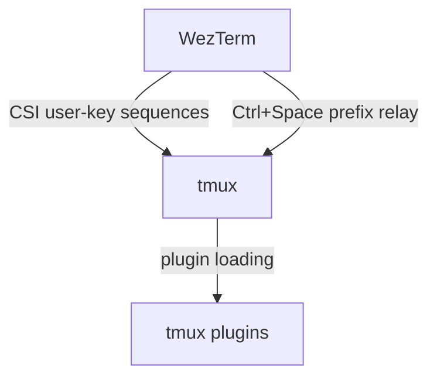

# Architecture: WezTerm → tmux

Two layers own the terminal workflow. WezTerm provides the GPU-rendered terminal and native macOS integration. tmux provides persistent sessions, windows, panes, key bindings, and the status bar.

## WezTerm layer

WezTerm owns GPU rendering, font and color configuration, fullscreen behavior, tab and pane lifecycle, and translating Cmd+* keystrokes into escape sequences tmux can bind.

Keybindings are defined as data tables in `xdg-configs/wezterm/wezterm.lua`:

- **`prefix_relay`** — Cmd+1..9 and Cmd+Shift+F send Ctrl+Space plus a key to tmux prefix mode.
- **`csi_relay`** — session navigation, session creation, the session chooser, and copy mode use tmux `user-keys`.
- **`vim_relay`** — Cmd+S, Cmd+J, Cmd+D, and related editor actions send CSI sequences consumed by Neovim.

WezTerm also handles Cmd+Tab session toggling by invoking tmux directly. It does not maintain session state or implement a second session UI.

## tmux layer

tmux owns sessions, windows, panes, key bindings, status bar rendering, and plugin loading through tpm. The configuration lives at `~/.config/tmux/tmux.conf` (XDG path).

The status bar uses tmux's native format strings and refresh interval. Session switching uses tmux's built-in `switch-client` and `choose-tree` commands. Alt+* bindings handle window and pane navigation directly in tmux without terminal-specific state.

The prefix (`Ctrl+Space`) is reserved for less-common operations such as window renaming, session detach, plugin commands, and the session chooser.

## Keybinding hierarchy

| Modifier | Layer | Scope | Examples |
|---|---|---|---|
| **Cmd+*** | WezTerm → tmux (CSI/prefix relay) | Session/window-level | Cmd+N (new session), Cmd+P (chooser), Cmd+1..9 (window select) |
| **Alt+*** | tmux (direct) | Window/pane-level | Alt+H/J/K/L (pane navigation), Alt+1..9 (window select) |
| **Ctrl+Space** | tmux prefix | Infrequent operations | prefix+d (detach), prefix+$ (rename session), prefix+s (chooser) |
| **Cmd+* (vim)** | WezTerm → Neovim (CSI relay) | Editor commands | Cmd+S (save), Cmd+J (diagnostics), Cmd+D (multicursor) |

## Why this stack

tmux is the session multiplexer because it survives terminal crashes, supports remote attach, and has a mature plugin ecosystem. WezTerm is the terminal because it provides native macOS integration, programmatic configuration, and the key relay needed to bridge macOS Cmd+* bindings into tmux's key model.
